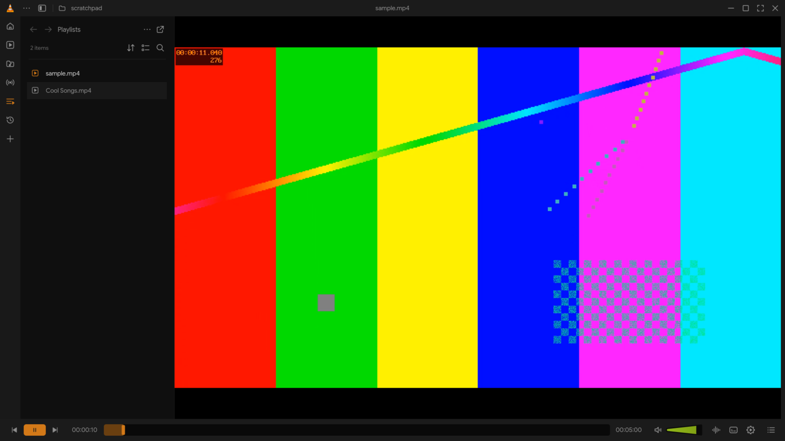
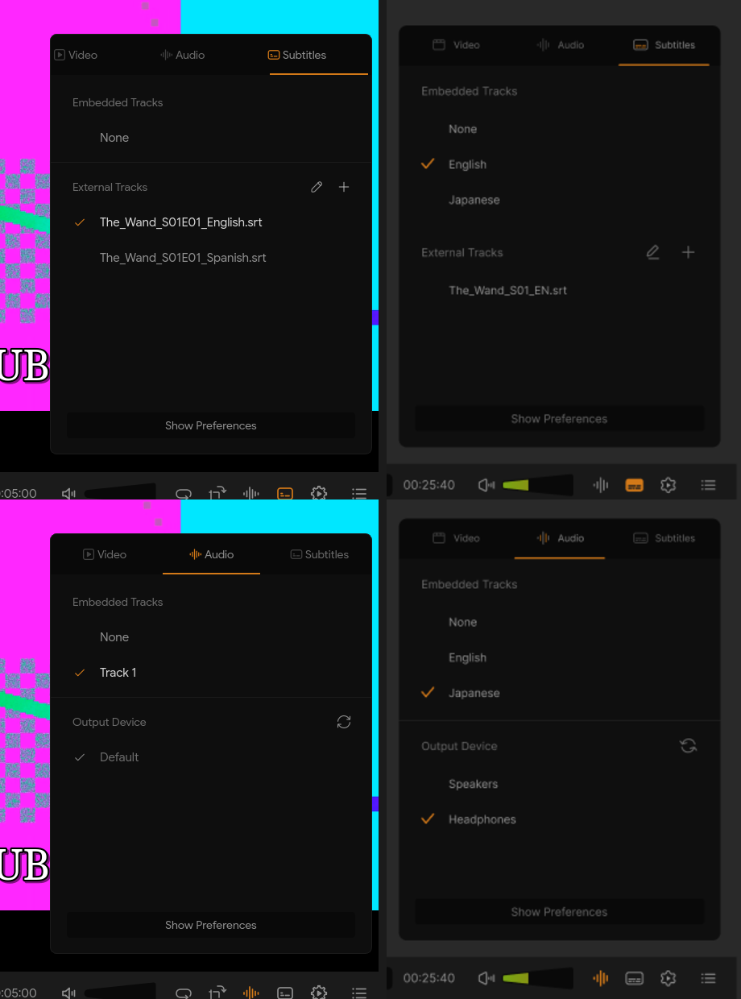
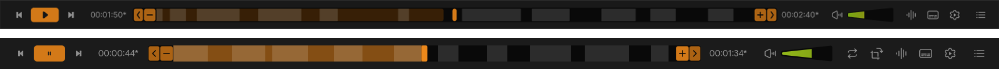

# VLC Redesign

A redesigned Qt interface for **VLC media player 3.0.24**, built from the
*VLC Redesign* concept by **Juxtopposed** on the Figma Community. The whole
player is VLC 3.0.24 — the same decoders, formats and settings — with a new
interface: frameless window, library, music mode, queue, settings and
dialogs, matched to the Figma file and set in Google Sans.

> **Unofficial.** This is an independent project. It isn't made, endorsed or
> supported by VideoLAN, and the Figma concept's designer isn't involved.
> For the official player, see [videolan.org](https://www.videolan.org/vlc/).



## Download

Get the latest build from [**Releases**](../../releases).

| Platform | File | Notes |
|---|---|---|
| Windows 10 / 11 (64-bit) | `vlc-redesign-…-win64-setup.exe` | Installer |
| Windows 10 / 11 (64-bit) | `vlc-redesign-…-win64.zip` | Portable: unzip and run `vlc.exe` |
| Arch Linux / CachyOS (x86_64) | `vlc-redesign-…-x86_64.pkg.tar.zst` | `sudo pacman -U <file>`, then run `vlc-redesign` |

Each release lists SHA-256 checksums in `SHA256SUMS`.

**Before installing on Windows**

- **The installer replaces an installed official VLC.** It still installs
  as "VLC media player", in the same folder. To keep the official player,
  use the portable zip instead; it runs from any folder.
- **The builds aren't code-signed**, so SmartScreen warns on first run.
  Choose *More info → Run anyway* if you trust the download.
- **Windows builds are cross-compiled from Linux.** See
  [Known limitations](#known-limitations).

The Arch package installs to `/opt/vlc-redesign` and leaves the system's
`vlc` alone.

## What's new

| Area | What changed |
|---|---|
| Player | Frameless window with its own header (menu, library toggle, folder, title, window buttons); navigation rail; one-row control bar with an accent play pill, a 28 px seek bar and a volume cone |
| Fullscreen | Auto-hiding top strip and control bar; seek-bar preview thumbnails |
| Menus | Main menu with shortcuts and profiles; Video / Audio / Subtitles track popover; item, sort and view menus |
| Adjustments | Four-tab side panel: video, audio, subtitles and playback |
| Dialogs | Open Network Stream, New Playlist, Add Subtitles (folder, link or OpenSubtitles search) |
| Library | Folder scan with thumbnails, Home with a resume card, Recent, browse and list views, a mini player |
| Music | Song tags and cover art, music categories, a music-mode bar with a waveform seek bar |
| Playlists and queue | Named playlists; Queue / Bookmarks / Chapters panel; drag to the queue |
| Settings | Settings window with 13 pages; Keyboard Shortcuts dialog where keys apply without a restart |
| Subtitles | Optional subtitle timeline on the seek bar; `Ctrl+B` quick bookmark; bookmarks kept per file |
| Look | Dark, light or system theme; nine accent colours |

<table>
  <tr>
    <td></td>
    <td></td>
  </tr>
  <tr>
    <td align="center"><sub>Main menu — build (left) and Figma (right)</sub></td>
    <td align="center"><sub>Track popover — build (left) and Figma (right)</sub></td>
  </tr>
</table>


<sub>Subtitle timeline — Figma (top) and build (bottom)</sub>

## Options

Everything is in **Settings**; these are the same options from the command
line or `vlcrc`.

| Option | Default | What it does |
|---|---|---|
| `--qt-redesign` / `--no-qt-redesign` | on | The redesigned interface; off gives VLC's classic Qt interface |
| `--qt-redesign-frameless` | on | Frameless window with the custom header; off keeps the system title bar |
| `--qt-theme` | `dark` | `dark`, `light` or `system` |
| `--qt-accent-color` | `#D37918` | Amber, Rust, Olive, Green, Teal, Blue, Violet, Magenta or Grey |
| `--qt-subtitle-timeline` | off | Subtitle blocks on the seek bar while a subtitle file plays |
| `--qt-key-quick-bookmark` | `Ctrl+B` | Bookmark the current position |
| `--qt-library-roots` | Videos and Music | Folders the library scans, separated by `;` |

## Building from source

The interface lives in `modules/gui/qt/`. Everything else is VLC 3.0.24.

**Linux (development build)**

```bash
./bootstrap
./configure --enable-qt
make -j"$(nproc)"
./vlc
```

**Arch Linux package**

```bash
cd tools/redesign/packaging/arch
makepkg -si          # -s installs the build dependencies, -i the package
```

**Windows (cross-compiled from Linux)**

Needs `mingw-w64-gcc`, `mingw-w64-tools` and `nsis`, plus VideoLAN's
prebuilt win64 contribs unpacked in `contrib/x86_64-w64-mingw32`.

```bash
tools/redesign/packaging/windows/build.sh all
```

That script also explains the two build-time shims it links: VideoLAN's
contribs ship Qt 5.6 and were built for the older msvcrt runtime.
`modules/gui/qt/util/qt_compat.*` keeps the interface building on Qt 5.6
and 5.15.

## Known limitations

- **Windows builds haven't been tested on Windows yet.** They're
  cross-compiled and checked statically: 64-bit binaries that import only
  Windows system DLLs.
- **Windows: no online subtitle search.** VideoLAN's Windows Qt has no
  network module. Adding subtitles from a folder or a link works.
- **Windows: no SRT streaming and English only.** The prebuilt SRT library
  doesn't link with the current toolchain, and the interface is built
  without translations.
- **Customize Player** (drag-and-drop layout editor) is in progress and not
  in these builds.

## Credits and licences

- **VLC media player** — © the VideoLAN team and contributors,
  GPL-2.0-or-later / LGPL-2.1-or-later. See [`COPYING`](COPYING),
  [`COPYING.LIB`](COPYING.LIB) and [`AUTHORS`](AUTHORS); VLC's own readme
  is [`README`](README).
- **Design** — *VLC Redesign* by Juxtopposed, published on the Figma
  Community.
- **Google Sans** — SIL Open Font License 1.1
  ([`OFL.txt`](modules/gui/qt/pixmaps/redesign/fonts/OFL.txt)).
- **Iconoir** icons, used where the Figma file has none — MIT
  ([`ICONOIR-LICENSE`](modules/gui/qt/pixmaps/modern/ICONOIR-LICENSE)).

"VLC" and the cone are trademarks of VideoLAN; they're used here only to
name the software this is built on.
