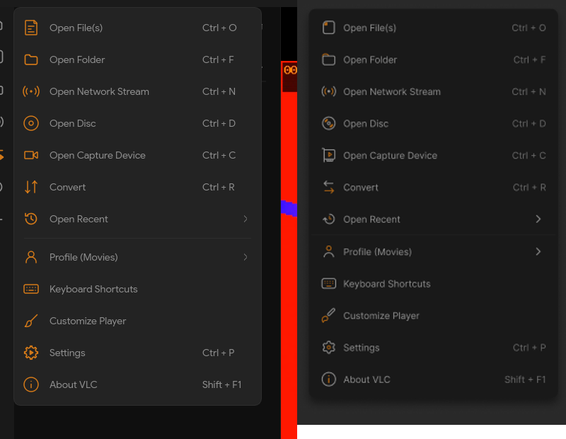

# VLC Redesign

Hey! This is VLC 3.0.24 with a completely new look.

It all started with Juxtopposed's video,
[I Redesigned VLC After 25 Years](https://youtu.be/ERFeOgqk324). If you haven't
seen it, go watch it, it's great. She reimagined VLC's interface and shared the
whole thing as a [Figma file](https://www.figma.com/community/file/4UaxYzCN8lGeBI9uEAeWhN).
I loved it so much I wanted to actually use it, so I built it into the real VLC.

Under the hood it's still the VLC you know: same codecs, same formats, same
settings. Only the interface is new.


> Heads up: this is an unofficial build. It isn't made or supported by
> VideoLAN, and Juxtopposed isn't involved in it either. If you want the
> official player, grab it from [videolan.org](https://www.videolan.org/vlc/).

## Her design, plus my own touches

The look and layout come from Juxtopposed's design, and I followed her Figma
file closely: the header, the rail, the single control bar, the volume cone,
the library, music mode, the menus and the dialogs. Her icons too, wherever
the file had them.

A Figma file is mostly still pictures, though, so plenty of it I had to decide
on my own. Some of it is just my taste:

- **All the motion.** Panels sliding in, fades, hover effects, how things
  open and close. Most of that isn't spelled out in the design, so it's how I
  like it to feel. It runs at your screen's refresh rate.
- **A brighter seek bar fill.** The original was a bit too dark for me.
- **Icons she didn't draw.** For those I used [Iconoir](https://iconoir.com),
  since the style is close.
- **Things her screens hint at but don't spell out:** the zoomed subtitle
  timeline, seek-preview thumbnails, the waveform in music mode, keyboard
  shortcuts and how settings behave.

So if something feels off, that's probably on me, not her.

## Download

Grab the latest build from [Releases](../../releases).

| You're on | Get | Then |
|---|---|---|
| Windows 10 / 11 (64-bit) | `…-win64-setup.exe` | Run the installer |
| Windows 10 / 11 (64-bit) | `…-win64.zip` | Unzip anywhere and run `vlc.exe` |
| Arch Linux / CachyOS | `…-x86_64.pkg.tar.zst` | `sudo pacman -U <file>`, then run `vlc-redesign` |

There's a `SHA256SUMS` file with each release if you want to check your
download.

A few things to know on Windows:

- **The installer replaces an official VLC if you have one**, because it
  installs as "VLC media player" in the same folder. Want to keep both? Use
  the zip; it runs from any folder.
- **Windows will warn you on first launch** because the builds aren't signed.
  Click *More info*, then *Run anyway*.
- **I build the Windows version on Linux**, so bug reports from Windows
  users really help. If something breaks, please open an issue.

On Arch, everything goes in `/opt/vlc-redesign`, so your normal `vlc` stays
untouched.

## What you get

- **The player:** a frameless window with its own title bar, a navigation rail
  on the left, and one clean control bar with the cone-shaped volume slider.
- **Fullscreen:** the controls hide when you're watching, and hovering the seek
  bar shows a little preview of that moment.
- **A library:** your videos and music, a home screen that remembers where you
  stopped, recents, and a mini player.
- **Music mode:** cover art, song info, and a seek bar that shows the
  song's waveform.
- **Playlists and the queue,** plus bookmarks and chapters in one side panel.
  Drag stuff into the queue.
- **Adjustments:** video, audio, subtitles and playback settings in a panel
  that slides in from the right.
- **A new Settings window** with 13 pages, and a shortcuts editor where
  changes work immediately.
- **Subtitles:** an optional timeline on the seek bar showing each subtitle,
  and `Ctrl+B` to drop a quick bookmark (saved per file).
- **Live TV:** free channels from [iptv-org](https://github.com/iptv-org/iptv)
  by category, language or country, shown as cards with each channel's
  logo. Pick one and the whole list becomes your queue, so Next and
  Previous flip channels.
- **A smarter queue:** search it with `Ctrl+F` (thousands of channels are
  fine), see each channel's group, and save it as a playlist that keeps
  channel names and logos.
- **Themes:** dark, light or follow your system, with nine accent colours.

<table>
  <tr>
    <td></td>
    <td></td>
  </tr>
  <tr>
    <td align="center"><sub>Main menu: mine on the left, her Figma on the right</sub></td>
    <td align="center"><sub>Track picker: mine on the left, her Figma on the right</sub></td>
  </tr>
</table>


<sub>Subtitle timeline: her Figma on top, mine below</sub>

## Tweaking it

Everything's in Settings, but these work from the command line too:

| Option | Default | What it does |
|---|---|---|
| `--no-qt-redesign` | (on) | Turn the new look off and get classic VLC back |
| `--no-qt-redesign-frameless` | (on) | Keep your system's normal title bar |
| `--qt-autohide-controls` | `2` | When the bars slide away: `0` never, `1` fullscreen only, `2` also while a video plays in the window |
| `--qt-theme` | `dark` | `dark`, `light` or `system` |
| `--qt-accent-color` | `#D37918` | Amber, Rust, Olive, Green, Teal, Blue, Violet, Magenta or Grey |
| `--qt-subtitle-timeline` | off | Show subtitles on the seek bar |
| `--qt-key-quick-bookmark` | `Ctrl+B` | The quick-bookmark key |
| `--qt-library-roots` | Videos, Music | Folders the library scans, separated by `;` |

## Building it yourself

Almost all my changes live in `modules/gui/qt/`. The one other is VLC's M3U
reader (`modules/demux/playlist/m3u.c`), which now picks up IPTV channel
logos and groups. The rest is stock VLC 3.0.24.

On Linux:

```bash
./bootstrap
./configure --enable-qt
make -j"$(nproc)"
./vlc
```

The Arch package:

```bash
cd tools/redesign/packaging/arch
makepkg -si
```

The Windows build is cross-compiled from Linux. You need `mingw-w64-gcc`,
`mingw-w64-tools` and `nsis`, plus VideoLAN's prebuilt win64 libraries. This
grabs them for you:

```bash
tools/redesign/packaging/windows/fetch-contribs.sh .
```

Then:

```bash
tools/redesign/packaging/windows/build.sh all
```

The script has notes on the two small workarounds it needs. VideoLAN's Windows
libraries ship an older Qt (5.6) and an older C runtime, so
`modules/gui/qt/util/qt_compat.*` keeps everything building on both.

## Known issues

- On Windows, searching subtitles online doesn't work, because VideoLAN's
  Windows Qt has no network module. Adding them from a file or a link is fine.
- On Windows there's no SRT streaming, and the interface is English only.
- Customize Player (drag and drop your own control layout) is still in the
  works.
- Live TV channels come from public lists, so some are offline, geo-blocked
  or only on at certain times. A dead one shows a short message and the
  next channel starts. Channel logos and flags (from flagcdn.com) download
  the first time you see them.

## Who made this

- **The design:** [Juxtopposed](https://www.youtube.com/@juxtopposed). Her
  video [I Redesigned VLC After 25 Years](https://youtu.be/ERFeOgqk324) and her
  [Figma file](https://www.figma.com/community/file/4UaxYzCN8lGeBI9uEAeWhN)
  are where all of this comes from. Seriously, go check out her channel.
- **The build:** me, [Immanuvel B](https://github.com/Inman2004)
  ([rvinmandev.vercel.app](https://rvinmandev.vercel.app)). I put it into VLC,
  added the motion and the bits the design didn't cover, and packaged it for
  Linux and Windows.
- **VLC itself:** the [VideoLAN](https://www.videolan.org) team and
  contributors. None of this exists without them.

## Licences

VLC is free software under the GPL 2.0 or later (see [`COPYING`](COPYING)),
with libVLC under the LGPL 2.1 or later ([`COPYING.LIB`](COPYING.LIB)). This is
a modified version of VLC 3.0.24.
[`NOTICE.txt`](tools/redesign/packaging/NOTICE.txt) sums up what I changed and
when, and it ships in every package. The git history has the full details.

Also bundled:

- the Google Sans font, under the SIL Open Font License 1.1
  ([`OFL.txt`](modules/gui/qt/pixmaps/redesign/fonts/OFL.txt));
- Iconoir icons, under the MIT License
  ([`ICONOIR-LICENSE`](modules/gui/qt/pixmaps/modern/ICONOIR-LICENSE)).

"VLC", "VLC media player", "VideoLAN" and the cone logo are VideoLAN's
trademarks. I only use them to say what this is built on, which
[VideoLAN's legal page](https://www.videolan.org/legal.html) allows for builds
that follow the GPL.

VLC's original readme is still here as [`README`](README).
